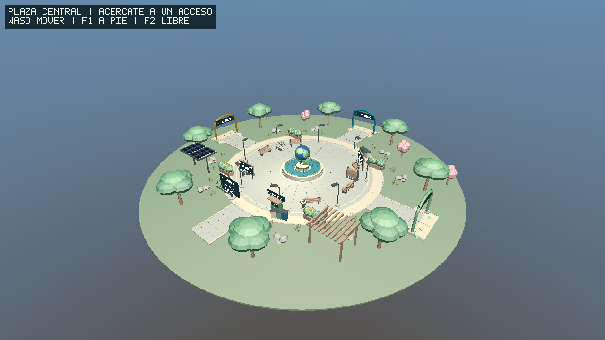
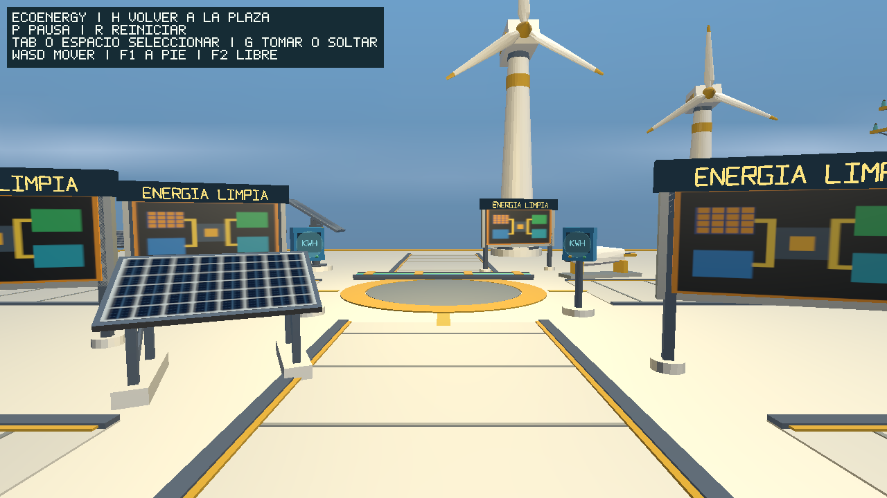
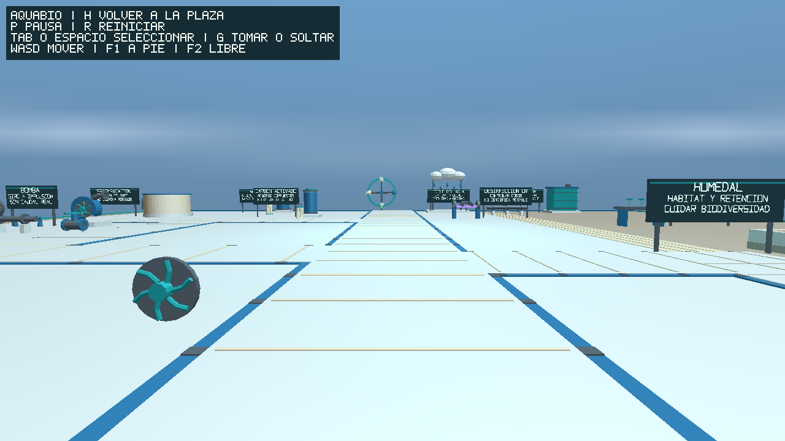
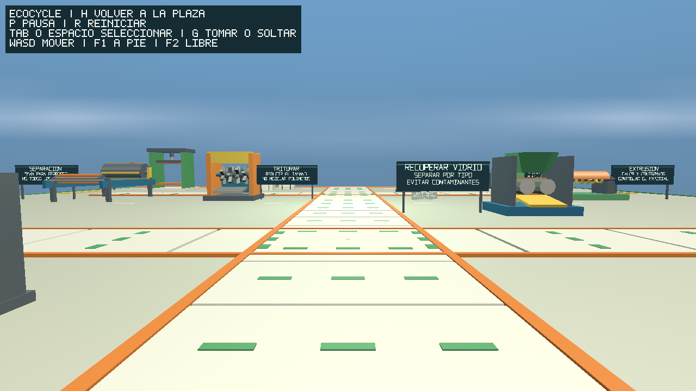

# EcoSphere

**Interactive 3D Environmental Education Platform** · C++17 · OpenGL 3.3 Core · Blender

EcoSphere es un entorno educativo tridimensional dedicado a la sostenibilidad. Desde una plaza central se pueden explorar tres instalaciones temáticas, observar recursos medioambientales y utilizar controles de cámara, interacción y animación. Se encuentra en **desarrollo colaborativo**; el empaquetado definitivo para Windows todavía no está validado.

## Explora las cuatro zonas

### Plaza central



Punto de encuentro y acceso a las instalaciones, con elementos paisajísticos, señalización y recursos educativos compartidos.

### EcoEnergy · Energías renovables



Instalación sobre energía solar y eólica, sistemas eléctricos y movilidad sostenible.

### AquaBio · Agua y biodiversidad



Instalación dedicada a captación y tratamiento del agua, humedales y conservación de ecosistemas.

### EcoCycle · Reciclaje y economía circular



Instalación dedicada a separación, recuperación y reutilización de materiales.

## Qué incluye esta base

| Elemento | Total actual |
|---|---:|
| Modelos originales únicos | 110 |
| Instancias de modelos | 252 |
| Interacciones educativas | 20 |
| Animaciones | 24 (12 simples, 6 keyframe, 6 procedurales) |
| Instalaciones | 3, más una plaza central |

El proyecto es una demostración educativa: los instrumentos representados son interpretativos, no equipos calibrados; no incorpora colisiones físicas generales ni certificación de accesibilidad.

## Controles

| Acción | Tecla |
|---|---|
| Desplazamiento | W / A / S / D |
| Orientación de cámara | Flechas |
| Cámara en primera persona / cámara libre | F1 / F2 |
| Subir / bajar en cámara libre | Q / E |
| Entrar a una instalación (junto al acceso) | Enter |
| Volver a la plaza | H |
| Seleccionar / siguiente / deseleccionar objeto | Espacio / Tab / Backspace |
| Trasladar objeto seleccionado | J / L, U / O, I / K |
| Rotar / escalar objeto | Z / X, C / V |
| Tomar / soltar | G |
| Pausar o reanudar / reiniciar animaciones | P / R |
| Mostrar / ocultar FPS | F3 |
| Salir | Esc |

El contador FPS aparece inicialmente y renueva la lectura cada ~0.5 s.
`FPS: -` indica una muestra pendiente; se reinicia al perder foco o minimizar.

## Ejecución rápida

Con las dependencias preparadas, los lanzadores encuentran el proyecto desde
cualquier directorio. Sin opciones abren la plaza y compilan si falta el binario.

```bash
./run-linux.sh          # Linux: abrir la plaza
./run-linux.sh --build  # Solo compilar
./run-linux.sh --test   # Compilar y ejecutar CTest
```

En Developer PowerShell for Visual Studio: `.\run-windows.ps1`,
`.\run-windows.ps1 -Build` o `.\run-windows.ps1 -Test`.
Windows sigue **sin validación nativa**. Ayuda: `--help` / `-Help`.
Requisitos y errores frecuentes en [la guía de compilación](docs/BUILD.md).
Los scripts no instalan paquetes ni cambian la configuración global.

## Compilar y ejecutar

La configuración validada hasta la fecha es **Linux (Arch Linux)**. Requiere CMake 3.24+, Ninja, compilador C++17, Python 3.10+ para las pruebas, una implementación de OpenGL 3.3 Core y GLFW **3.5.1** disponible como paquete CMake. El proyecto no descarga dependencias automáticamente.

```bash
cmake --preset linux-dev
cmake --build --preset linux-dev
ctest --preset linux-dev --output-on-failure
./build/linux-dev/ecosphere --plaza
```

Si la configuración no encuentra GLFW en su versión exacta, consulta [la guía de compilación](docs/BUILD.md); no cambies el requisito silenciosamente. Windows/MSVC está previsto, pero todavía no validado.

## Integrantes y contribuciones

Responsabilidades del trabajo colaborativo; no describen un historial individual de aportaciones.

| Integrante | Área de trabajo |
|---|---|
| Perez Olvera Alexis Abraham | Arquitectura, integración y EcoEnergy |
| Cruz Macedo Samuel Santiago | EcoCycle, modelado e interacciones |
| Basilio Illescas Andres | AquaBio, modelado y experiencias educativas |

## Arquitectura y participación

- [Arquitectura del motor y SDK v1.0](docs/ARCHITECTURE.md)
- [Evolución técnica por fases](docs/DEVELOPMENT_PHASES.md)
- [Modelos, Blender e inventarios](docs/ASSETS.md)
- [Cómo contribuir](CONTRIBUTING.md)
- [Créditos verificados y contribuciones pendientes](CONTRIBUTORS.md)
- [Alcance de licencias](LICENSE_SCOPE.md)

El código y los modelos constituyen una base ampliable. Los cambios deben proponerse en ramas y revisarse mediante pull requests antes de entrar en `main`.
