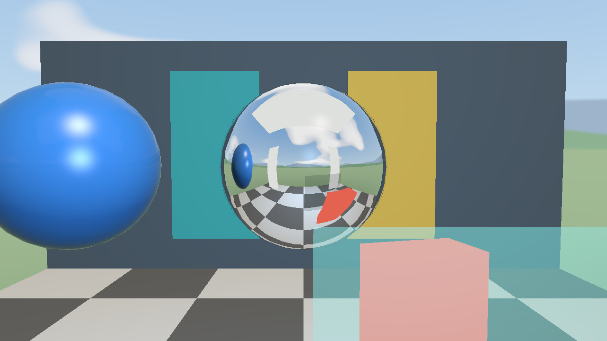

# Prototipo aislado de cromo

## Diagnóstico previo a la implementación

Base verificada: `fab50c1e1c9eb2ecf7f39575dcc7f04a12c68b0c`, rama estable
`fix/presentation-textures-sync`. `origin/main`: `0732ad343434f2983f2d98a2454dc516b09488b2`.
El experimento vive exclusivamente en `experiment/chrome-reflections`.

La esfera metálica educativa ya tiene metallic=1, roughness=0,12,
specular=1 y reflection=1, pero su color base es dorado (0,83; 0,65; 0,32).
La textura base modula el color: no incorpora reflejos del mundo.
Phong y Blinn-Phong producen brillos de las luces directas; metallic suprime
la contribución difusa y colorea el especular. Fresnel-Schlick pondera la
reflexión según el ángulo y el F0 metálico depende del color base.

El entorno actual es un cubemap procedural estático RGB8 lineal de seis caras
de 512²: cielo, paisaje, nubes y sol. No contiene las estaciones ni los modelos
cercanos. Su contenido poco estructurado, el tinte dorado y la geometría low-poly
limitan el parecido con cromo pulido. Aumentar el contraste de `metal.png` no
puede crear reflejos del entorno. Roughness reduce la mezcla ambiental en el
shader actual, pero no genera convolución/prefiltrado del cubemap. El modelo
no es una BRDF microfacet completa ni un renderizador de trazado de rayos.

## Alcance y técnica prevista

Un ejecutable independiente reutiliza `makeLightingDemo`, `ModelRenderer`,
`Environment` y los shaders originales sin alterarlos. A conserva el metal
dorado; B usa color neutro 0,92, metallic=1 y roughness=0,04 con el cielo actual;
C conserva exactamente ese material y usa una captura estática local.
Las tres versiones comparten la misma sala procedural de geometría real.

OpenGL 3.3 permite adjuntar individualmente las seis caras de un cubemap a un
framebuffer mediante `FramebufferTexture2D`; RGBA16F es un formato de color
renderizable. Por tanto, seis cámaras de 90° bastan para una captura estática,
sin cambiar el renderizador. Fuente: [especificación OpenGL 3.3, secciones
3.9 y 4.4](https://registry.khronos.org/OpenGL/specs/gl/glspec33.core.pdf).

La captura se realiza una sola vez en el centro de la esfera y excluye la
propia esfera. Solo esta esfera utiliza el cubemap capturado. Los otros objetos
siguen usando el cielo original. No hay probes dinámicos, rebotes múltiples,
corrección de paralaje ni reflejos en tiempo real de objetos móviles.

## Comparación controlada

| Estado | Color base lineal | Metallic | Roughness | Specular / reflection | Entorno de la esfera |
|---|---|---|---|---|---|
| A, metal educativo actual | 0,83 / 0,65 / 0,32 | 1 | 0,12 | 1 / 1 | Cielo original |
| B, cromo con entorno existente | 0,92 / 0,92 / 0,92 | 1 | 0,04 | 1 / 1 | Cielo original |
| C, cromo con captura local | Igual a B | 1 | 0,04 | 1 / 1 | Sala experimental capturada |

A es el material de `makeLightingDemo`, no una nueva modificación de los metales
de las instalaciones. La esfera conserva sus 561 vértices, normales suaves,
UV, índices y transformación. No tiene textura base ni normal map.
El aspecto sigue siendo estilizado: no se ha calibrado contra datos ópticos
del cromo ni se dispone aquí de la imagen original para medir fidelidad exacta.

La sala agrega piso ajedrezado, paneles turquesa y amarillo y paneles blancos
unlit. Estos últimos son geometría visible en el cubemap; no son luces nuevas,
no iluminan otros objetos ni equivalen a una simulación de iluminación global.
Las luces originales de la demo permanecen idénticas. El cubemap captura también
la esfera azul y los paneles transparentes originales, sin el reflector.

La esfera se dibuja antes del entorno para conservar la oclusión y composición
de los paneles transparentes. Las otras superficies mantienen el cubemap original
en los tres estados. El cielo de fondo siempre es el original.

### Cámaras y capturas

Framebuffer sRGB real 1280×720, perspectiva 45°, near=0,05, far=60.
Centro del reflector: (2; 2,65; −1,5), radio 0,72. El punto observado es
centro+(0;0;0,72), con normal +Z. Ojos relativos al centro:
frontal (0;0,15;3,6), rasante (3,6;0,15;0,9). La incidencia sobre ese punto fijo
es aproximadamente 3° y 87°. Una esfera tiene normales rasantes también en
la silueta de una vista frontal: no se interpreta la imagen completa como
un único ángulo de incidencia.

Cada vista incluye A/B/C, Phong y Blinn-Phong y reflexión ambiental ON/OFF.
Fresnel sigue activado. OFF desactiva las reflexiones ambientales de todos los
materiales conservando el cielo visible. En cada combinación B-OFF y C-OFF
deben coincidir exactamente; B-ON y C-ON solo difieren por el entorno de la esfera.
Con metallic=1, F0=0,92 y Fresnel hacia 1 en rasante, la variación angular es
menor que en vidrio: no se exagera para hacerla más llamativa.

Se conservan además 24 frames por estado con cámara recorriendo −60° a +60°,
radio 3,6 y altura relativa 0,15. La escena no tiene animación temporal, todas
las matrices y luces son constantes y el cubemap no se vuelve a capturar.
Las imágenes PNG son conversiones sin pérdida de RGB leído con `glReadPixels`:
solo se invierte el orden vertical del framebuffer. No hay retoques ni exposición
posterior. Las animaciones de vista usan los mismos frames, a 12 fps.

### Reproducción

```bash
cmake --preset linux-dev
cmake --build --preset linux-dev
ctest --preset linux-dev --output-on-failure
./build/linux-dev/chrome_reflections_demo --variant A
./build/linux-dev/chrome_reflections_demo --variant B
./build/linux-dev/chrome_reflections_demo --variant C
MESA_GL_VERSION_OVERRIDE=3.3 MESA_GLSL_VERSION_OVERRIDE=330 \
  ./build/linux-dev/chrome_reflections_demo --evidence /tmp/chrome-new-evidence
```

El modo visible orbita automáticamente y se cierra con el gestor de ventanas.
No incorpora controles a EcoSphere ni modifica su navegación o HUD.
El directorio de evidencia debe ser nuevo: el ejecutable rechaza sobrescribirlo.
Los overrides Mesa se usaron solo en procesos de validación Linux; no son
requisitos para una implementación nativa OpenGL 3.3 de otro proveedor.

## Resultados visuales

**Dictamen: el cromo se reconoce claramente en C.** B elimina el tinte dorado,
pero sigue mostrando principalmente cielo y terreno uniforme. C muestra el
ajedrezado del piso, los paneles blancos, la esfera azul y las formas de la sala,
con una deformación coherente con la normal y la dirección de observación.
La diferencia se aprecia en la esfera completa, sin ampliar detalles.
En este cromo la contribución ambiental domina y las diferencias entre Phong
y Blinn son pequeñas; los lóbulos directos se aprecian mejor en la esfera azul
vecina. No se aumentaron ni cambiaron exponentes para exagerarlas.



Los objetos reflejados que se identifican proceden **exclusivamente del cubemap
capturado al inicio**. La esfera no consulta la geometría cercana durante cada
frame. Los brillos directos continúan procediendo de las dos luces originales;
el cielo visible fuera de la esfera procede de `Environment`. El panel transparente
en primer plano oculta parcialmente la zona inferior derecha en la vista frontal;
se conserva idéntico en A/B/C y la vista rasante permite ver mejor la esfera.

| Vista y sombreado | A ON | B ON | C ON | A OFF | B OFF | C OFF |
|---|---|---|---|---|---|---|
| Frontal Blinn | [A](evidence/chrome-reflections/A-front-BLINN-PHONG-on.png) | [B](evidence/chrome-reflections/B-front-BLINN-PHONG-on.png) | [C](evidence/chrome-reflections/C-front-BLINN-PHONG-on.png) | [A](evidence/chrome-reflections/A-front-BLINN-PHONG-off.png) | [B](evidence/chrome-reflections/B-front-BLINN-PHONG-off.png) | [C](evidence/chrome-reflections/C-front-BLINN-PHONG-off.png) |
| Rasante Blinn | [A](evidence/chrome-reflections/A-grazing-BLINN-PHONG-on.png) | [B](evidence/chrome-reflections/B-grazing-BLINN-PHONG-on.png) | [C](evidence/chrome-reflections/C-grazing-BLINN-PHONG-on.png) | [A](evidence/chrome-reflections/A-grazing-BLINN-PHONG-off.png) | [B](evidence/chrome-reflections/B-grazing-BLINN-PHONG-off.png) | [C](evidence/chrome-reflections/C-grazing-BLINN-PHONG-off.png) |
| Frontal Phong | [A](evidence/chrome-reflections/A-front-PHONG-on.png) | [B](evidence/chrome-reflections/B-front-PHONG-on.png) | [C](evidence/chrome-reflections/C-front-PHONG-on.png) | [A](evidence/chrome-reflections/A-front-PHONG-off.png) | [B](evidence/chrome-reflections/B-front-PHONG-off.png) | [C](evidence/chrome-reflections/C-front-PHONG-off.png) |
| Rasante Phong | [A](evidence/chrome-reflections/A-grazing-PHONG-on.png) | [B](evidence/chrome-reflections/B-grazing-PHONG-on.png) | [C](evidence/chrome-reflections/C-grazing-PHONG-on.png) | [A](evidence/chrome-reflections/A-grazing-PHONG-off.png) | [B](evidence/chrome-reflections/B-grazing-PHONG-off.png) | [C](evidence/chrome-reflections/C-grazing-PHONG-off.png) |

Cámara en movimiento: [A](evidence/chrome-reflections/A-motion.webp),
[B](evidence/chrome-reflections/B-motion.webp),
[C](evidence/chrome-reflections/C-motion.webp). Los 72 PNG individuales quedan
en el mismo directorio como `A/B/C-motion-00.png` a `23.png`, además de las 24
capturas fijas. [Manifiesto](evidence/chrome-reflections/captures.json) con hashes
de PNG y del RGB original; las 96 conversiones se comprobaron byte por byte
contra los datos originales del framebuffer.

## Validación técnica

- Configure y build completos satisfactorios, sin advertencias de compilación.
- **CTest 40/40**: se conservan las 39 pruebas anteriores y se agrega
  `chrome_scene_cpu`. Comprueba la conservación de los materiales originales,
  geometría, normales, UV, posición, jerarquía y la exclusión del reflector.
- GPU Intel Iris Xe (ADL GT2), Mesa 26.2.6-arch1.1, contexto **OpenGL 3.3 Core,
  GLSL 3.30**. Conversión sRGB real verificada: lineal 64, codificado 137.
- Las seis caras RGBA16F 512² tienen almacenamiento esperado y framebuffer
  completo; sin errores GL y estado del framebuffer, viewport y sRGB restaurado.
- B-OFF y C-OFF idénticos byte por byte en frontal/rasante y Phong/Blinn;
  ON cambia la reflexión, y el movimiento de cámara cambia la imagen.
- Regresión gráfica existente: demo, Plaza, EcoEnergy, AquaBio y EcoCycle
  dieron `changed=0 max=0` frente a la referencia Blinn. Las pruebas existentes
  de Phong, Fresnel, transparencias, normales y estado GL también pasan.
- HUD de iluminación y FPS: pruebas GPU satisfactorias en las cuatro zonas,
  incluyendo cambios de resolución y activación/desactivación.
- Navegación integral: cuatro zonas, **212 transiciones**, 12 vistas de recursos
  compartidos, salida limpia. El compositor concedió 1908×1023 en este smoke
  visible; no se usan sus capturas ni FPS para la comparación A/B/C de 1280×720.
- Interacción y animación: `INTERACTION SMOKE PASS`, acciones programadas CPU
  y capturas OpenGL, sin inyección de teclado del sistema.

Registros: [configure](evidence/chrome-reflections/configure.log),
[build](evidence/chrome-reflections/build.log),
[CTest](evidence/chrome-reflections/ctest.log),
[prototipo GPU](evidence/chrome-reflections/gpu.txt),
[sombreado original](evidence/chrome-reflections/original-shading.log),
[HUD](evidence/chrome-reflections/original-hud.log),
[FPS](evidence/chrome-reflections/original-fps.log),
[navegación](evidence/chrome-reflections/original-navigation.log),
[interacción](evidence/chrome-reflections/original-interaction.log).

## Rendimiento y memoria

Medición final sin otras pruebas del proyecto ejecutándose, mismo framebuffer
1280×720, cámara frontal, luces, objetos y Blinn-Phong. VSync solicitado=0.
Tres pasadas en orden ABC/CBA/BCA, 30 frames de calentamiento y 120 medidos
por estado/pasada, `glFinish` en cada frame. Se mide dibujo sincronizado sin
intercambiar buffers: los FPS son el inverso del tiempo de dibujo, **no FPS de
navegación de EcoSphere ni una garantía de presentación en pantalla**.

| Estado | Media ms (360 frames) | FPS equivalentes | p95 por pasada, intervalo ms |
|---|---:|---:|---:|
| A | 4,184 | 239,03 | 4,013–7,256 |
| B | 3,308 | 302,29 | 3,941–4,678 |
| C | 3,777 | 264,75 | 4,092–5,466 |

Datos completos: [performance.csv](evidence/chrome-reflections/performance.csv).
C frente a B registra +0,469 ms (+14,2%) y −12,4% FPS equivalentes en el promedio.
Sin embargo, A varía entre 191 y 308 FPS entre pasadas: frecuencias, temperatura,
carga del compositor y cachés del controlador no están fijadas. No se atribuye
esa diferencia íntegramente a la reflexión ni se afirma una mejora de rendimiento.
Las tres configuraciones conservan el cubemap capturado residente durante la
medición; el modo visible A/B no lo crea.

La captura inicial tardó **13,818 ms**, incluido upload temporal y sincronización;
no se repite durante la órbita. Almacenamiento nominal persistente adicional:
**12 MiB** (6×512²×RGBA16F), más aproximadamente 1 MiB temporal de profundidad,
liberado después de capturar. El RSS pasó de 165348 a 165932 KiB (+584 KiB),
sin cambio adicional tras dibujar C. Ese RSS no mide VRAM: es una GPU integrada
con memoria compartida y asignaciones/cachés del controlador. No se dispone de
una medición independiente de memoria GPU residente y no se confunde el delta
de RSS con el tamaño real de la textura.

## Conservación y decisión

Los [hashes iniciales](evidence/chrome-reflections/baseline.json) y la
[verificación final](evidence/chrome-reflections/integrity.json) confirman que
los 266 archivos protegidos y el binario original de EcoSphere siguen idénticos.
Incluyen todos los GLB de las instalaciones, las seis texturas procedurales,
shaders, renderer, entorno, SDK, navegación, HUD, animaciones y controles.
Pasan también integridad y regeneración de texturas de la suite anterior.
No se tocaron inventarios, licencias, créditos ni documentación/evidencia histórica.

Se añaden `src/experiments/ChromeScene.hpp`, `ChromeReflections.cpp`,
`tests/chrome_scene_tests.cpp`, este informe y sus evidencias. `CMakeLists.txt`
agrega exclusivamente el ejecutable separado y la prueba CPU.

Limitaciones: cubemap estático desde un único centro, ausencia de corrección
de paralaje y actualización de objetos, una sola reflexión indirecta aproximada,
512² con filtrado bilineal sin prefiltrado por rugosidad, aristas de reflejos
con aliasing y discretización de normales de la esfera low-poly. El material
no es una reproducción física calibrada del cromo. No se ejecutó Windows ni se
comparó con la imagen de referencia original, que no está disponible en este entorno.

**Recomendación:** conservarlo como demostración experimental independiente para
auditoría. La técnica produce el efecto buscado sin refactorización del motor,
pero no trasladarla a las instalaciones antes de la exposición: su correcta
integración exigiría elegir ubicaciones/capturas y validar paralaje, memoria y
rendimiento por superficie. La versión estable permanece lista para continuar
su auditoría sin depender de este experimento. No crear PR ni realizar merge.
