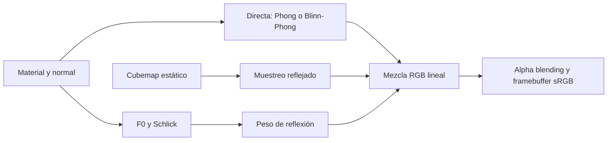

# Phong, Blinn-Phong y Fresnel en EcoSphere

## Objetivo académico y alcance

Esta ampliación permite comparar dos técnicas de iluminación directa y una técnica
de texturizado ambiental para Computación Gráfica e Interacción Humano-Computadora.
La comparación separa tres decisiones: modelo especular directo, reflectancia
angular y muestreo del entorno. No convierte el shader educativo en un PBR completo.

Base pública: `f82c2881758555fb54bc9c4d41440bbee0b9bf95`, último `origin/main`
consultado tras fetch. Rama `feature/phong-fresnel-materials`, creada con Git limpio
en el directorio habitual. No se creó otro worktree ni se modificó main.
La [auditoría inicial](evidence/phong-fresnel/baseline-audit.txt) describe el pipeline
previo; configuración/compilación correctas y [36/36 pruebas iniciales](evidence/phong-fresnel/baseline-ctest.txt).

Se conservan los 110 modelos, 252 instancias, 20 interacciones y 34 animaciones del
main actual. No cambian GLB, Blender, texturas, posiciones, módulos, materiales de
instalación, SDK v1.0 ni lanzadores. Se reutiliza `makeLightingDemo()` sin modificar
su geometría ni los ajustes Matte, Plastic, Metal y Glass.

## Phong: vector reflejado

El modelo de Phong usa la dirección de reflexión para describir un brillo especular.
Referencia: Bui Tuong Phong, *Illumination for Computer Generated Pictures* (1975),
Communications of the ACM 18(6), 311–317, [texto original](https://users.cs.northwestern.edu/~ago820/cs395/Papers/Phong_1975.pdf).

En nuestro shader, N es la normal mundial normalizada, L apunta desde la superficie
hacia la luz y V desde la superficie hacia el observador. Por tanto el vector
incidente es **−L**, no L. GLSL calcula:

```text
R = reflect(-L, N) = 2 N dot(N,L) - L
D = max(dot(N,L), 0)
S_P = D > 0 ? max(dot(R,V), 0)^nP : 0
```

La convención de `reflect` está especificada por [Khronos](https://registry.khronos.org/OpenGL-Refpages/gl4/html/reflect.xhtml)
([fuente oficial legible](https://github.com/KhronosGroup/OpenGL-Refpages/blob/main/gl4/reflect.xml)).
Se conserva ambiente, Lambert, color especular del material, luces direccional y
puntual, atenuación y normal transformada. No aparece especular desde el lado no
iluminado. Un cambio de cámara modifica V, no el material ni la potencia de la luz.

## Blinn-Phong y correspondencia de parámetros

Blinn sustituye el vector reflejado por el halfway vector. Referencia: James F.
Blinn, *Models of Light Reflection for Computer Synthesized Pictures*, SIGGRAPH
1977, 192–198, [DOI editorial](https://doi.org/10.1145/563858.563893),
[copia del artículo](https://people.computing.clemson.edu/~ekp/courses/dpa8090/assets/papers/Blinn1977Shading.pdf).

El camino anterior permanece literalmente disponible:

```text
H = normalize(L + V)
S_B = D > 0 ? max(dot(N,H), 0)^nB : 0
nB = 2 + 254 (1 - roughness)^4
nP = nB / 4
```

La última relación es una aproximación didáctica, no una identidad. Si L=N y V se
aparta un ángulo pequeño θ del máximo, Phong usa cos(θ)^nP y Blinn cos(θ/2)^nB.
Con log(cos θ) ≈ −θ²/2 se obtiene nB ≈ 4nP. Fuera de ese entorno las formas difieren;
la aproximación es peor para lóbulos anchos. No se iguala su energía integrada.
La relación roughness/exponente existente es heurística, no una distribución GGX.

| Propiedad | Phong | Blinn-Phong |
|---|---|---|
| Vector especular | R = reflect(−L,N) | H = normalize(L+V) |
| Producto del brillo | R·V | N·H |
| Exponente en EcoSphere | nB/4, rango 0.5–64 | Fórmula original, rango 2–256 |
| Cámara/material/luces | Iguales en cada pareja | Iguales en cada pareja |
| Modo inicial | No | **Sí**, conserva referencias |

El color directo sigue siendo, por luz de radiancia Li:

```text
C_direct = ambient C (1-metallic)
         + sum_i Li [ C (1-metallic) D_i + Cs S_i ]
Cs = mix(specular.xxx, C, metallic)
Li_puntual = color * intensidad / (kc + kl*d + kq*d²)
```

No se cambian los coeficientes del material al alternar F5.

## Fresnel-Schlick: reflectancia angular

Referencia: Christophe Schlick (1994), *An Inexpensive BRDF Model for Physically-based
Rendering*, Computer Graphics Forum 13(3), 233–246,
[DOI/editorial verificados](https://onlinelibrary.wiley.com/doi/10.1111/1467-8659.1330233).
Se conserva la aproximación ya implementada:

```text
F0 = mix(vec3(0.04), C, metallic)
F(theta) = F0 + (1-F0) (1-clamp(dot(N,V),0,1))^5
```

El SDK existente permite variar `fresnelPower`; el valor original y usado aquí es
**5**. Otros exponentes son controles didácticos y no la fórmula estándar exacta.
En dieléctricos se usa F0=0.04, compatible con la aproximación de interfaz aire/vidrio
con índice cercano a 1.5; no hay parámetro IOR importado. En metales se conserva
F0 RGB derivado del color base, no un F0 blanco incrementado para exagerar el brillo.
El workflow disponible se contrasta con la [especificación glTF 2.0](https://registry.khronos.org/glTF/specs/2.0/glTF-2.0.html#materials).

| Material de demo | metallic | roughness | specular | reflection | Alfa |
|---|---:|---:|---:|---:|---:|
| Matte | 0 | 0.95 | 0.03 | 0 | 1 |
| Plastic | 0 | 0.18 | 0.8 | 0.6 | 1 |
| Metal | 1 | 0.12 | 1 | 1 | 1 |
| Glass | 0 | 0.10 | 0.9 | 0.55 | **0.32** |

Para el metal de demo, C=(0.83,0.65,0.32), se conservan esos mismos valores como F0.
Son valores artísticos RGB disponibles, no una medición espectral de un metal real.
Las pruebas CPU verifican F(0°)=F0, F(90°)=1 y monotonía para metal y dieléctrico.

## Iluminación, cubemap y materiales combinados

Iluminación directa y Fresnel no son categorías mutuamente excluyentes. Un metal
puede usar Phong o Blinn-Phong **y** reflexión angular del entorno. El cubemap es una
textura de seis caras, aquí procedurales y estáticas; no una nueva luz puntual.
La dirección de muestreo es `reflect(-V,N)`.

El shader mantiene su mezcla educativa anterior:

```text
w = clamp(F * reflection * environmentIntensity * (1 - 0.6*roughness), 0, 1)
C_resultado = mix(C_direct, texture(cubemap, reflect(-V,N)).rgb, w)
```

No integra iluminación difusa del entorno ni usa una BRDF microfacet normalizada,
GGX, prefiltrado de roughness, LUT BRDF o iluminación global. Roughness atenúa aquí
la reflexión y controla el exponente directo; no desenfoca físicamente el cubemap.
Por estas razones no se presenta el resultado como PBR glTF completo.



En los opacos alfa=1. MASK descarta según cutoff. BLEND conserva alfa de material y
textura, dibujado de opacos antes de transparentes, orden global por profundidad de
instancia y depth writes desactivados para BLEND. La composición lineal es:

```text
C_final = alpha * C_resultado + (1-alpha) * C_fondo
```

No hay refracción, transmisión volumétrica, Snell, Beer-Lambert, dispersión ni
extensiones glTF nuevas. El orden por origen de instancia es aproximado si varias
superficies transparentes se entrecruzan. No se cambió globalmente ninguna opacidad.
Unlit y legacy unlit evitan iluminación/reflexión; MASK, double-sided, textura base,
normales geométricas de respaldo y framebuffer sRGB conservan sus caminos.

## Selector, HUD y demostración interactiva

**F5** alterna una vez por PRESS. REPEAT/RELEASE no alternan. Inicialmente se usa
`ShadingModel::BlinnPhong`; el enum vive dentro del motor y no amplía LightingSettings
ni el SDK público. El mismo estado de selección alimenta renderer y HUD.
Se conserva al cambiar de zona. **0 restaura tanto la iluminación original de la
zona como Blinn-Phong**; no restaura cámara, animación, recursos, F3, F4 ni regresión.
1–6 y F1–F4 mantienen sus funciones; 4 apaga reflexión y 5 solo la representación
del cielo. En regresión el modo seleccionado queda almacenado para el pase normal.

En 1280×720 el HUD muestra `SOMBREADO: BLINN-PHONG | F5`; en 640×360 una fila F5;
en 320×240 `F5 BLINN` o `F5 PHONG` junto a 0/F4. Se conserva la caché del texto.
Las doce combinaciones zona/tamaño de la prueba histórica del HUD pasan sin cambios
fuera del panel, preservando FPS, ayudas y estado OpenGL.

Para observar la escena académica, ejecutar el binario **sin `--plaza`**:

```bash
./build/linux-dev/ecosphere
```

Los lanzadores abren Plaza por defecto. En la demo se pueden usar F2/flechas/WASD
para acercarse al plástico, al metal y al vidrio; F5 cambia la especular y 4 permite
ver la contribución ambiental. No hace falta cambiar los modelos de instalación.

## Comparaciones reales de framebuffer

Todas las parejas usan idéntica cámara, material, luces, resolución 1280×720 y
codificación sRGB. [Cámaras/estados](evidence/phong-fresnel/captures.csv).
No hay exposición automática ni edición de las imágenes. Los PNG son conversiones
sin pérdida de `glReadPixels`. Las posiciones de cámara cambian únicamente entre
las vistas frontal/rasante, no dentro de cada pareja ON/OFF.

| Comparación | Primera captura | Segunda captura | Píxeles con suma delta RGB >12 | Máximo delta por canal |
|---|---|---|---:|---:|
| Plástico opaco, misma cámara | [Blinn](evidence/phong-fresnel/opaque-blinn.png) | [Phong](evidence/phong-fresnel/opaque-phong.png) | 2254 | 28 |
| Metal frontal, Schlick/F0 constante | [Schlick](evidence/phong-fresnel/metal-normal-fresnel-on.png) | [F0](evidence/phong-fresnel/metal-normal-fresnel-off.png) | 8421 | 91 |
| Metal rasante, reflexión completa | [ON](evidence/phong-fresnel/metal-grazing-fresnel-on.png) | [OFF, como tecla 4](evidence/phong-fresnel/metal-grazing-reflection-off.png) | 54206 | 219 |
| Vidrio frontal, Schlick/F0 | [Schlick](evidence/phong-fresnel/glass-normal-fresnel-on.png) | [F0](evidence/phong-fresnel/glass-normal-fresnel-off.png) | 0 | 1 |
| Vidrio rasante, Schlick/F0 | [Schlick](evidence/phong-fresnel/glass-grazing-fresnel-on.png) | [F0](evidence/phong-fresnel/glass-grazing-fresnel-off.png) | 479 | 9 |
| Vidrio rasante, reflexión completa | [ON](evidence/phong-fresnel/glass-grazing-fresnel-on.png) | [OFF, como tecla 4](evidence/phong-fresnel/glass-grazing-reflection-off.png) | 969 | 10 |
| Cubemap completo | [ON](evidence/phong-fresnel/cubemap-on.png) | [Sin mapa ni cielo](evidence/phong-fresnel/cubemap-off.png) | 901661 | 221 |
| Solo representación del cielo | [ON](evidence/phong-fresnel/cubemap-on.png) | [Cielo OFF, reflejos ON](evidence/phong-fresnel/skybox-off-reflections-on.png) | 891321 | 179 |

**Fresnel OFF en la comparación aislada** significa sustituir la variación angular
por F0 constante, manteniendo el cubemap: es un control interno del renderer usado
por la prueba/benchmark. **Reflexión OFF** significa desactivar toda esa contribución,
como con la tecla 4. No se presentan ambas operaciones como si fueran equivalentes.

Con vidrio frontal se espera F≈F0: no hubo diferencias que superaran el umbral, pero
el máximo fue un código de color, no una identidad bit a bit. La cámara rasante
(~82.6° respecto a la normal en el centro) hace observable el efecto sin intensificar
F0, reflection ni alfa. Un primer ensayo a ~71.6° resultó demasiado sutil para ese
umbral; se conservó en build y se eligió una cámara mejor, no un umbral menor.
En una esfera metálica, incluso una cámara frontal observa normales rasantes cerca
de la silueta: no debe interpretarse toda la imagen como incidencia normal uniforme.
Los conteos indican contraste visual, no un porcentaje de realismo o de error físico.

## Referencia Blinn y las cuatro zonas

La prueba compila el fragment original de `f82c288` como referencia y usa idéntico
vertex shader, geometría, cubemap y cámara. Se añaden solo dos uniforms y un guard
inactivo en su configuración de referencia para que el renderer pueda enlazarlo;
las expresiones originales no se sustituyen. [Fuente original](evidence/phong-fresnel/reference-model.frag)
y [hashes iniciales](evidence/phong-fresnel/baseline-renderer.sha256).

Demo, Plaza, EcoEnergy, AquaBio y EcoCycle dieron **máximo delta 0 y cero píxeles
diferentes** entre la referencia y el Blinn nuevo en Intel/Mesa.
El test permite hasta un código por canal por redondeo de compilación/driver;
en esta ejecución no se necesitó esa tolerancia. No se afirma igualdad entre GPUs
ni entre capturas históricas con distinta resolución/cámara/HUD.

| Zona | Blinn actual | Phong |
|---|---|---|
| Plaza | [Captura](evidence/phong-fresnel/hub-BLINN-PHONG.png) | [Captura](evidence/phong-fresnel/hub-PHONG.png) |
| EcoEnergy | [Captura](evidence/phong-fresnel/ecoenergy-BLINN-PHONG.png) | [Captura](evidence/phong-fresnel/ecoenergy-PHONG.png) |
| AquaBio | [Captura](evidence/phong-fresnel/aquabio-BLINN-PHONG.png) | [Captura](evidence/phong-fresnel/aquabio-PHONG.png) |
| EcoCycle | [Captura](evidence/phong-fresnel/ecocycle-BLINN-PHONG.png) | [Captura](evidence/phong-fresnel/ecocycle-PHONG.png) |

El manifiesto de regresión de Plaza conserva su verificación de hashes: se actualizan
solo model.frag y ModelRenderer.cpp/.hpp, modificados por esta autorización, y se
agrega el nuevo Shading.hpp para protegerlo también. No se regeneran arbitrariamente
inventarios ni se omiten aserciones. [Registro explícito de cambios de hash](evidence/phong-fresnel/authorized-hash-changes.csv).
Las otras entradas del manifiesto y los hashes de GLB/texturas permanecen intactos.

## Pruebas y reproducción

```bash
cmake --preset linux-dev
cmake --build --preset linux-dev --parallel 2
ctest --preset linux-dev --output-on-failure
env -u WAYLAND_DISPLAY ./build/linux-dev/shading_graphics_tests \
  build/linux-dev build/linux-dev/phong-comparison \
  docs/evidence/phong-fresnel/reference-model.frag
python3 tests/shading_input.py build/linux-dev/ecosphere build/linux-dev/shading-input.log
```

X11/xdotool solo se requieren para la prueba opcional de teclado nativo Linux.
Se envían eventos exclusivamente a una ventana propia comprobada por PID.
El test gráfico requiere contexto real y no se añade a CTest para mantener su uso
sin pantalla. CPU verifica reflexión con signo correcto, lado no iluminado,
variación angular, lóbulos distintos, parámetros/selector inválidos, determinismo,
Fresnel normal/rasante/monotonía, F5/0/HUD y conservación de poses/recursos.

GPU comprueba compilación/enlace, selector inválido, comparación numérica de un
panel con normal constante en 0/30/60° para ambos modelos, especular cero a contraluz,
unlit invariante, MASK, BLEND en espacio lineal, normal de respaldo y double-sided.
El panel analítico reutiliza geometría de la demo en una copia CPU con coeficientes
conocidos; no se añade contenido al inventario de instalaciones. Tolerancia analítica:
0.006 en RGB lineal para cuantización sRGB de 8 bits y muestreo raster; no se usa
para ocultar diferencias de modelos. La prueba histórica conserva su umbral original.

[Registro GPU](evidence/phong-fresnel/graphics.txt),
[teclado real F5 mantenida/F3/F4/0/1–6](evidence/phong-fresnel/native-input.txt),
[regresión histórica del HUD](evidence/phong-fresnel/hud-regression.txt),
[iluminación histórica](evidence/phong-fresnel/legacy-lighting.txt) y
[GLB/unlit histórico](evidence/phong-fresnel/legacy-unlit.txt).
La prueba antigua de iluminación confirmó alfa lineal 0.32 en 7744/7744 píxeles
comparables y conservó MASK. Ninguna prueba anterior fue eliminada.

Validación final: **37/37 CTest** en 58.98 s, tras la compilación final
y la actualización documentada del manifiesto. [Salida completa](evidence/phong-fresnel/ctest.txt).
Se conservan todas las 36 pruebas anteriores y se añade `shading_cpu`.

## Rendimiento: CPU/presentación y GPU separados

Intel Iris Xe (ADL GT2), Mesa 26.2.6, OpenGL 4.6 Core, GLSL 330, GLFW 3.5.1;
Linux x86_64, GCC 16.2.1, CMake 4.4.5. Se solicitó OpenGL 3.3 Core; el contexto
obtenido fue 4.6. No se presenta como validación de todos los drivers 3.3.

Misma demo/cámara/materiales/luces, 1280×720; 30 frames de calentamiento y 300 por
caso, tres pasadas con swap solicitado 0 y una con swap 1. El orden Phong/Blinn
se alterna. Fresnel OFF conserva F0. Cada frame termina con swap y glFinish:
FPS y frametime miden finalización serial, **no throughput ilimitado ni solo shader**.
GL_TIME_ELAPSED añade el tiempo del paso de dibujo GPU; tampoco es un perfil exclusivo
de la ALU especular. No se introducen temporizadores ni glFinish por frame en la app.

La tabla siguiente promedia FPS/medias por pasada; el rango p95 muestra mínimo y
máximo de los percentiles de cada pasada, no un percentil agrupado inventado.
El p95 por pasada es el elemento 285 de 300 duraciones ordenadas (nearest rank).
| Modelo | Fresnel angular | Swap solicitado | Pasadas × frames | FPS medio | Frame medio ms | Rango p95 frame ms | GPU media ms | Rango p95 GPU ms |
|---|---|---:|---:|---:|---:|---:|---:|---:|
| BLINN-PHONG | ON | 0 | 3 × 300 | 53.70 | 18.623 | 19.184–19.334 | 0.584 | 0.600–0.601 |
| BLINN-PHONG | OFF (F0) | 0 | 3 × 300 | 53.67 | 18.630 | 19.198–19.266 | 0.581 | 0.599–0.600 |
| PHONG | ON | 0 | 3 × 300 | 53.79 | 18.589 | 19.266–19.291 | 0.558 | 0.595–0.599 |
| PHONG | OFF (F0) | 0 | 3 × 300 | 53.62 | 18.647 | 19.250–19.315 | 0.567 | 0.593–0.598 |
| BLINN-PHONG | ON | 1 | 1 × 300 | 53.90 | 18.553 | 19.177–19.177 | 0.584 | 0.599–0.599 |
| BLINN-PHONG | OFF (F0) | 1 | 1 × 300 | 53.55 | 18.672 | 19.270–19.270 | 0.585 | 0.599–0.599 |
| PHONG | ON | 1 | 1 × 300 | 53.64 | 18.641 | 19.250–19.250 | 0.582 | 0.597–0.597 |
| PHONG | OFF (F0) | 1 | 1 × 300 | 53.75 | 18.605 | 19.286–19.286 | 0.516 | 0.594–0.594 |

[CSV completo](evidence/phong-fresnel/performance.csv). Los FPS rondan 54 incluso
con swap 0 solicitado, mientras el paso GPU ronda 0.514–0.586 ms. El tiempo restante
incluye CPU, sincronización y presentación; no se midieron esas partes por separado.
No se atribuye ese límite al shader ni se afirma haber obtenido presentación
realmente desacoplada de VSync. La variación entre pasadas es mayor que algunas
diferencias entre modos: no demuestra que Phong sea más rápido ni que desactivar
Schlick produzca un ahorro significativo. No se detectó una regresión importante
entre estos casos, pero no se extrapola a otros equipos, resoluciones o escenas.

## Límites, almacenamiento y trazabilidad

Windows conserva preset y scripts, pero no fue ejecutado: falta compilación/CTest
MSVC y validación gráfica nativa. No hay refraction/transmission, sombras físicas,
PBR completo ni reflexiones dinámicas. El vidrio sigue siendo transparente por alfa,
con efecto angular sutil a incidencia normal. No se manipulan opacidades para
presentar una diferencia mayor. Las capturas anteriores no se sobrescriben.

Se reutilizó `build/linux-dev`. Tamaño inicial total: **3184759197 bytes**; medición
antes de los commits: **3561425369 bytes**, crecimiento ~359 MiB, inferior
a 2 GiB. Incluye intentos y PPM conservados bajo build; no se ejecutó limpieza.
El resultado final posterior al push se entrega con el informe de cierre.

Archivos de implementación: model.frag, ModelRenderer.cpp/.hpp, Shading.hpp,
LightingControls.hpp y main.cpp. Build/pruebas: CMakeLists.txt, shading_tests.cpp,
shading_graphics_tests.cpp, shading_input.py y el manifiesto de hashes explicado.
README/BUILD y este documento describen controles, teoría, resultados y límites.
Las capturas y CSV nuevos viven solo en `docs/evidence/phong-fresnel/`.
No se cambian créditos, licencias, referencias ni imágenes anteriores.

## Bibliografía verificable

1. Phong, B. T. (1975). *Illumination for Computer Generated Pictures*.
   Communications of the ACM, 18(6), 311–317. [Artículo original en archivo universitario](https://users.cs.northwestern.edu/~ago820/cs395/Papers/Phong_1975.pdf).
2. Blinn, J. F. (1977). *Models of Light Reflection for Computer Synthesized Pictures*.
   SIGGRAPH '77, 192–198. [DOI](https://doi.org/10.1145/563858.563893),
   [registro bibliográfico](https://dblp.org/rec/conf/siggraph/Blinn77.html),
   [copia universitaria](https://people.computing.clemson.edu/~ekp/courses/dpa8090/assets/papers/Blinn1977Shading.pdf).
   El acceso automático al editor devolvió 403 y la copia PDF agotó tiempo de espera;
   no se afirma haber consultado su texto completo en esta sesión.
3. Schlick, C. (1994). *An Inexpensive BRDF Model for Physically-based Rendering*.
   Computer Graphics Forum, 13(3), 233–246. [Editorial y DOI](https://onlinelibrary.wiley.com/doi/10.1111/1467-8659.1330233).
4. Khronos Group. *GLSL reflect reference*. [Referencia](https://registry.khronos.org/OpenGL-Refpages/gl4/html/reflect.xhtml),
   [fuente oficial](https://github.com/KhronosGroup/OpenGL-Refpages/blob/main/gl4/reflect.xml).
5. Khronos Group. *glTF 2.0 Specification*, materiales metallic-roughness y cobertura
   alfa. [Especificación oficial](https://registry.khronos.org/glTF/specs/2.0/glTF-2.0.html).

Las ecuaciones, aproximaciones concretas y resultados descritos corresponden al
código y las mediciones de EcoSphere; las referencias no certifican este renderer
como una implementación física completa ni garantizan una evaluación académica.
